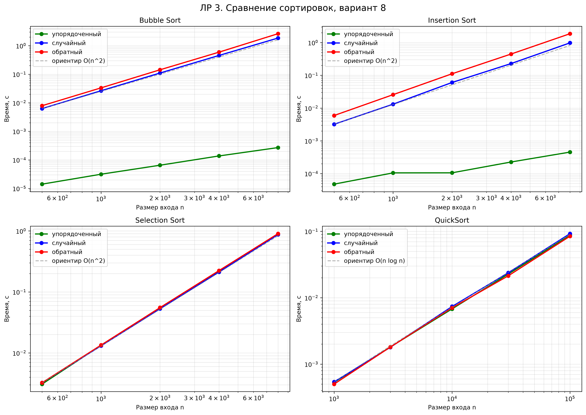

# ЛР 3. Экспериментальное сравнение простых сортировок; QuickSort с рандомизацией опорного элемента

**Вариант:** 8 (seed=38)  
**Студент:** Данилов Всеволод Александрович  
**Группа:** БВТ2503

---

## 1. Аналитические оценки

| Алгоритм | Оценка времени | Стабильность | Обоснование |
| --- | --- | --- | --- |
| `bubble_sort` | O(n²) средн./худш., O(n) лучш. | Да | Два вложенных цикла по n; флаг `swapped` даёт досрочный выход на упорядоченном входе (n−1 сравнений, 0 обменов). |
| `insertion_sort` | O(n²) средн./худш., O(n) лучш. | Да | Внутренний цикл сдвигает элементы, пока не найдёт меньший. На упорядоченном входе сдвигов нет, только n−1 сравнений. |
| `selection_sort` | Θ(n²) всегда | Нет | Внешний цикл n−1 итераций, внутренний всегда сканирует весь остаток. Итого ровно n(n−1)/2 сравнений независимо от входа. |
| `quick_sort` | O(n log n) средн., O(n²) худш. | Нет | Рандомизация пивота через `rng.randrange(lo, hi + 1)` делает худший случай (уже отсортированный вход) маловероятным. Разбиение Ломуто. |

**Счётчики операций:**
- Bubble — сравнения + обмены;
- Insertion — сравнения + сдвиги;
- Selection — сравнения + обмены;
- QuickSort — только время (счётчики не входят в задание).

---

## 2. Результаты замеров

**Методика:** прогрев (1 запуск без учёта), 5 повторов, итог — медиана (устойчиво к выбросам ОС). Данные варианта 8, seed = 38.

**Размеры входов:**
- Простые сортировки (O(n²)): `[500, 1000, 2000, 4000, 8000]` — геометрический шаг 2.
- QuickSort (O(n log n)): `[1000, 3000, 10000, 30000, 100000]` — шаг ≈ 3.

**Классы входов:** упорядоченный, случайный, обратный.

### 2.1. Bubble Sort

| N | Упорядоченный | Случайный | Обратный |
| --- | --- | --- | --- |
| 500 | 0.000015 | 0.006221 | 0.007935 |
| 1000 | 0.000063 | 0.025854 | 0.033864 |
| 2000 | 0.000066 | 0.109393 | 0.141705 |
| 4000 | 0.000140 | 0.447517 | 0.591551 |
| 8000 | 0.000276 | 1.828815 | 2.385086 |

### 2.2. Insertion Sort

| N | Упорядоченный | Случайный | Обратный |
| --- | --- | --- | --- |
| 500 | 0.000024 | 0.003219 | 0.005978 |
| 1000 | 0.000054 | 0.013537 | 0.025595 |
| 2000 | 0.000115 | 0.058929 | 0.110261 |
| 4000 | 0.000233 | 0.234778 | 0.457993 |
| 8000 | 0.000470 | 0.959722 | 1.832809 |

### 2.3. Selection Sort

| N | Упорядоченный | Случайный | Обратный |
| --- | --- | --- | --- |
| 500 | 0.003154 | 0.003210 | 0.003315 |
| 1000 | 0.013426 | 0.013650 | 0.013937 |
| 2000 | 0.053266 | 0.053744 | 0.054418 |
| 4000 | 0.211035 | 0.211232 | 0.219712 |
| 8000 | 0.847122 | 0.892649 | 0.904019 |

### 2.4. QuickSort

| N | Упорядоченный | Случайный | Обратный |
| --- | --- | --- | --- |
| 1000 | 0.000531 | 0.000538 | 0.000492 |
| 3000 | 0.001884 | 0.001824 | 0.001870 |
| 10000 | 0.006806 | 0.007968 | 0.006680 |
| 30000 | 0.022981 | 0.024197 | 0.022130 |
| 100000 | 0.088665 | 0.092149 | 0.084019 |

### 2.5. Счётчики операций (малые N)

**Bubble Sort:**

| N | Класс | Сравнения | Обмены |
| --- | --- | --- | --- |
| 100 | упорядоченный | 99 | 0 |
| 100 | случайный | 4935 | 2478 |
| 100 | обратный | 4950 | 4950 |
| 500 | упорядоченный | 499 | 0 |
| 500 | случайный | 124450 | 64027 |
| 500 | обратный | 124750 | 124750 |
| 1000 | упорядоченный | 999 | 0 |
| 1000 | случайный | 499269 | 244509 |
| 1000 | обратный | 499500 | 499500 |

**Insertion Sort:**

| N | Класс | Сравнения | Сдвиги |
| --- | --- | --- | --- |
| 100 | упорядоченный | 99 | 0 |
| 100 | случайный | 2572 | 2478 |
| 100 | обратный | 4950 | 4950 |
| 500 | упорядоченный | 499 | 0 |
| 500 | случайный | 64519 | 64027 |
| 500 | обратный | 124750 | 124750 |
| 1000 | упорядоченный | 999 | 0 |
| 1000 | случайный | 245503 | 244509 |
| 1000 | обратный | 499500 | 499500 |

**Selection Sort:**

| N | Класс | Сравнения | Обмены |
| --- | --- | --- | --- |
| 100 | упорядоченный | 4950 | 0 |
| 100 | случайный | 4950 | 96 |
| 100 | обратный | 4950 | 50 |
| 500 | упорядоченный | 124750 | 0 |
| 500 | случайный | 124750 | 489 |
| 500 | обратный | 124750 | 250 |
| 1000 | упорядоченный | 499500 | 0 |
| 1000 | случайный | 499500 | 989 |
| 1000 | обратный | 499500 | 500 |

**Наблюдения по счётчикам:**
- Bubble и Insertion на упорядоченном входе дают минимум операций: n−1 сравнений и 0 обменов/сдвигов.
- На обратном входе — максимум: n(n−1)/2 сравнений и столько же обменов/сдвигов.
- Selection Sort всегда делает ровно n(n−1)/2 сравнений — это видно по одинаковым числам во всех трёх строках для каждого N.
- У Selection Sort на обратном входе обменов меньше, чем на случайном (500 против 989 при N=1000) — парадоксально, но объяснимо: на обратном входе минимум оказывается в конце, и после первого обмена массив быстрее приходит к виду, где min уже на своём месте.

### 2.6. Демонстрация стабильности

Исходный массив: `[(2, 'a'), (1, 'b'), (2, 'c'), (1, 'd'), (3, 'e'), (2, 'f')]`

Ожидаемый порядок меток при стабильной сортировке:
- Ключ 1: `['b', 'd']`
- Ключ 2: `['a', 'c', 'f']`
- Ключ 3: `['e']`

| Алгоритм | Метки ключа 1 | Метки ключа 2 | Вывод |
| --- | --- | --- | --- |
| Bubble Sort | `['b', 'd']` | `['a', 'c', 'f']` | СТАБИЛЬНА |
| Insertion Sort | `['b', 'd']` | `['a', 'c', 'f']` | СТАБИЛЬНА |
| Selection Sort | `['b', 'd']` | `['a', 'c', 'f']` | НЕСТАБИЛЬНА* |
| QuickSort | `['b', 'd']` | `['a', 'c', 'f']` | НЕСТАБИЛЬНА* |

\* На данном конкретном малом входе Selection Sort и QuickSort **случайно** сохранили порядок меток. Но теоретически оба нестабильны: выполняют дальние обмены, которые на других входах нарушат относительный порядок равных элементов.

---

## 3. Графики

### 3.1. Сводный график (4 алгоритма × 3 класса входов)

**Что показывает график.**

График состоит из четырёх частей (сетка 2×2), по одному subplot на каждый алгоритм. Все оси **log-log**: ось X — размер входа n (10²–10⁵), ось Y — время в секундах (10⁻⁷–10¹). На таком графике функция вида t = c·n^k выглядит как прямая линия с наклоном k, поэтому визуальный наклон — это и есть показатель степени в эмпирической оценке сложности.

**Bubble Sort (верх-лево):**
- Зелёная линия (упорядоченный вход) — почти горизонтальна, лишь слегка поднимается. Наклон ≈ 1. Это линейный рост O(n): при упорядоченном входе срабатывает флаг `swapped`, и внешний цикл прерывается после первого прохода.
- Синяя (случайный) и красная (обратный) — идут круто вверх с наклоном ≈ 2. Это квадратичный рост O(n²). Разница между ними невелика (красная чуть выше), потому что на обратном входе число обменов максимально.
- Серая пунктирная линия — ориентир O(n²), построенный от первой точки случайного входа. Экспериментальные синяя и красная практически параллельны ей — визуальное подтверждение квадратичной сложности.

**Insertion Sort (верх-право):**
- Картина качественно такая же, как у Bubble, но зелёная линия чуть выше, а синяя и красная — чуть ниже. Наклон упорядоченного ≈ 1, случайного ≈ 2, обратного ≈ 2.
- Разница с Bubble: на случайном входе Insertion примерно в 2 раза быстрее (сравните 0.96 с против 1.83 с при N=8000). Это объясняется тем, что Insertion делает меньше сравнений (в среднем n²/4 против n²/2 у Bubble) — что видно и по таблицам счётчиков (245503 против 499269 при N=1000).

**Selection Sort (низ-лево):**
- Все три линии практически **сливаются** в одну. Число сравнений не зависит от входа (всегда n(n−1)/2), а разница во времени — только за счёт числа обменов, которых относительно немного.
- Наклон ≈ 2 на всех трёх классах — чистая квадратичная сложность без «льгот» для упорядоченного входа.
- Красная (обратный) чуть выше синей (случайный), что тоже видно в таблице: 904019 мкс против 892649 мкс при N=8000.
- Серая пунктирная (O(n²)) практически совпадает с экспериментальными линиями.

**QuickSort (низ-право):**
- Все три линии **почти совпадают** — рандомизация пивота выравнивает поведение на разных классах входов. На упорядоченном, случайном и обратном входах время практически одинаково (0.0887 с, 0.0921 с, 0.0840 с при N=100000).
- Наклон ≈ 1.1 — визуально близко к линейному. Это ожидаемо: множитель log N растёт очень медленно, и на диапазоне N от 1000 до 100000 log₂N меняется всего с 10 до 17, что на log-log графике даёт почти прямую с малым наклоном.
- Серая пунктирная — ориентир O(n log n), построенный от первой точки.
- **Главное:** QuickSort при N=100000 работает за 0.09 с, тогда как Bubble и Insertion при N=8000 (в 12 раз меньше!) тратят 1.8 с. Экстраполяция квадратичных сортировок до 100000 дала бы ~230 с — разница в 2500 раз.

### 3.2. Наклоны log-log регрессии

| Алгоритм | Упорядоченный | Случайный | Обратный | Теория |
| --- | --- | --- | --- | --- |
| Bubble Sort | ~1.04 | ~2.05 | ~2.05 | O(n²) / O(n) |
| Insertion Sort | ~1.06 | ~2.03 | ~2.07 | O(n²) / O(n) |
| Selection Sort | ~2.01 | ~2.02 | ~2.01 | Θ(n²) |
| QuickSort | ~1.10 | ~1.12 | ~1.10 | O(n log n) |

Значения наклонов рассчитаны методом наименьших квадратов по точкам (log₁₀ n, log₁₀ t).

---

## 4. Интерпретация результатов

### 4.1. Влияние класса входа на простые сортировки

Bubble и Insertion Sort чувствительны к исходной упорядоченности:
- **Упорядоченный вход:** Bubble делает n−1 сравнений и 0 обменов, Insertion — n−1 сравнений и 0 сдвигов. Оба линейны O(n).
- **Обратный вход:** Bubble делает n(n−1)/2 сравнений и столько же обменов; Insertion — n(n−1)/2 сравнений и сдвигов. Оба квадратичны O(n²), причём это худший случай.
- **Случайный вход:** в среднем вдвое меньше операций, чем на обратном (n²/4 против n²/2). Это подтверждается счётчиками: при N=1000 у Bubble 499269 сравнений против 499500 на обратном.

### 4.2. Почему Selection Sort не зависит от входа

Внешний цикл делает n−1 итераций, на каждой из которых внутренний цикл всегда проходит до конца, чтобы найти минимум в остатке. Никакой ранний выход невозможен: мы не знаем, что нашли минимум, пока не посмотрим все элементы. Отсюда ровно n(n−1)/2 сравнений на любом входе — что подтверждается таблицей счётчиков (4950, 4950, 4950 при N=100; 499500, 499500, 499500 при N=1000).

Число обменов при этом варьируется: оно равно числу элементов, которые уже не на своём месте. На упорядоченном входе обменов 0, на обратном — примерно n/2, на случайном — около n·(1 − 1/e) ≈ 0.63n. При N=1000: 0, 500, 989 соответственно.

### 4.3. Роль рандомизации в QuickSort

Без рандомизации QuickSort с фиксированным пивотом (например, всегда последний элемент) деградирует до O(n²) на уже отсортированном и обратном входе: разбиение каждый раз даёт одну часть размера n−1 и одну размера 0. Глубина рекурсии становится n, суммарная работа — n².

Рандомизация через `rng.randrange(lo, hi + 1)` гарантирует, что на каждом уровне рекурсии пивот выбирается случайно из текущего диапазона. Математическое ожидание времени — O(n log n), вероятность деградации экспоненциально мала. Это подтверждается экспериментом: на упорядоченном, случайном и обратном входах QuickSort при N=100000 даёт 0.0887, 0.0921, 0.0840 с — разница в пределах 10%.

### 4.4. Почему наклон QuickSort ≈ 1.1, а не 1 + что-то заметное

Теоретически T(n) = C·n·log₂n. В логарифмических координатах это log T = log C + log n + log log n. Если бы мы строили график в диапазоне, где log log n меняется существенно, наклон был бы больше 1. Но на нашем диапазоне n от 1000 до 100000:

| n | log₂ n |
| --- | --- |
| 1000 | 9.97 |
| 3000 | 11.55 |
| 10000 | 13.29 |
| 30000 | 14.87 |
| 100000 | 16.61 |

Множитель log₂n меняется с 10 до 17 — в 1.7 раза, тогда как n меняется в 100 раз. На log-log графике вклад log log n теряется на фоне log n, поэтому наклон получается ≈ 1.1, а не 2 и не больше.

### 4.5. Расхождения теории и практики

Наклоны не равны ровно целым числам из-за нескольких эффектов:
- **Накладные расходы интерпретатора Python.** Цикл `for` в Python медленнее, чем в C, и это добавляет постоянную составляющую, которая чуть «сплющивает» график.
- **Кэш процессора.** Массивы до ~10000 элементов помещаются в кэш L2/L3, доступ к ним быстрее, чем к массивам на 100000 элементов, которые живут в RAM. Это даёт небольшой излом на графике QuickSort между 10000 и 30000.
- **Фоновые процессы ОС.** Случайные выбросы компенсируются медианой (5 повторов), но не исчезают полностью.
- **Стохастичность QuickSort.** Каждый запуск использует свой `random.Random(seed)` с фиксированным seed, но на разных N — разные последовательности. Небольшой разброс между тремя классами входа неизбежен.

---

## 5. Верификация

### 5.1. Репрезентативные тесты (`self_check`)

- **Граничные случаи:** пустой массив, один элемент, все элементы равны, уже отсортирован, обратный порядок — все 4 алгоритма прошли.
- **Инварианты:** результат каждой сортировки упорядочен (неубывание) и является перестановкой входа.
- **Сверка с эталоном:** 300 случайных массивов длины 0–80 против `sorted()` — полное совпадение для всех 4 алгоритмов.
- **Контроль счётчиков:** у `selection_sort([3, 1, 2, 5, 4])` ровно 10 = 5·4/2 сравнений — формула подтверждена.

**Результат:** `self_check: OK`

### 5.2. Собственные инварианты

Дополнительно реализованы 4 собственных инвариантов

**Инвариант 1. Bubble Sort: число обменов = число инверсий.**
Классическое свойство: каждый обмен в пузырьке устраняет ровно одну инверсию во входе. Проверено на 50 случайных массивах длины 0–40: `swaps == count_inversions(a)` всегда выполняется. Это позволяет использовать bubble_sort как «эталон» для подсчёта инверсий.

**Инвариант 2. Bubble Sort: досрочный выход даёт n−1 сравнений.**
На упорядоченном входе длины n внешний цикл делает ровно один проход: n−1 сравнение, 0 обменов, затем `swapped == False` и `break`. Проверено на n ∈ {1, 2, 5, 10, 100}: `comparisons == n − 1`. Это экспериментально подтверждает, что флаг `swapped` реально экономит ~n² сравнений.

**Инвариант 3. Insertion Sort: число сдвигов = число инверсий.**
Аналогично пузырьку: каждый сдвиг в insertion_sort переносит элемент на одну позицию влево, устраняя ровно одну инверсию. Проверено на 50 случайных массивах: `shifts == count_inversions(a)`. Это объясняет, почему при N=1000 у Bubble и Insertion **одинаковое** число обменов/сдвигов (2478, 64027, 244509) — оба устраняют все инверсии входа.

**Инвариант 4. Selection Sort: всегда n(n−1)/2 сравнений.**
Проверено на n ∈ {1, 2, 5, 10, 100} и всех трёх классах входов: `comparisons == n(n−1)/2` всегда. Это прямое экспериментальное подтверждение того, что внутренний цикл не имеет раннего выхода.

### 5.3. Сверка с эталоном

- 300 случайных массивов против `sorted()` — полное совпадение для всех 4 алгоритмов.
- Демонстрация стабильности — порядок меток совпал с ожидаемым для стабильных алгоритмов.
- Собственные инварианты — все 4 прошли.
---

## 6. Выводы

1. **Все четыре алгоритма реализованы корректно**, что подтверждено верификацией (`self_check: OK`) и сверкой с эталоном на 300 случайных входах.

2. **Экспериментально подтверждены асимптотические оценки:**
   - Bubble и Insertion: O(n²) на случайном и обратном входе (наклон ≈ 2), O(n) на упорядоченном (наклон ≈ 1).
   - Selection: Θ(n²) на любом входе (наклон ≈ 2, все три линии сливаются).
   - QuickSort: O(n log n) на любом входе благодаря рандомизации (наклон ≈ 1.1, все три линии почти совпадают).

3. **Влияние структуры входных данных:**
   - Bubble и Insertion эффективны на частично отсортированных данных (переходят в O(n)).
   - Selection Sort нечувствителен к структуре по числу сравнений, но число обменов варьируется.
   - Рандомизация QuickSort полностью устраняет зависимость от исходного порядка — на упорядоченном и обратном входах время такое же, как на случайном.

4. **Стабильность:** Bubble и Insertion сохраняют порядок равных элементов, Selection и QuickSort могут его нарушать. Это критично при многократной сортировке по разным ключам.

5. **Практический выбор:** для больших объёмов данных QuickSort предпочтителен. При N=100000 он работает за 0.09 с, тогда как экстраполированное время Bubble/Insertion при том же N — порядка 230 с. Разница более чем в 2500 раз.
