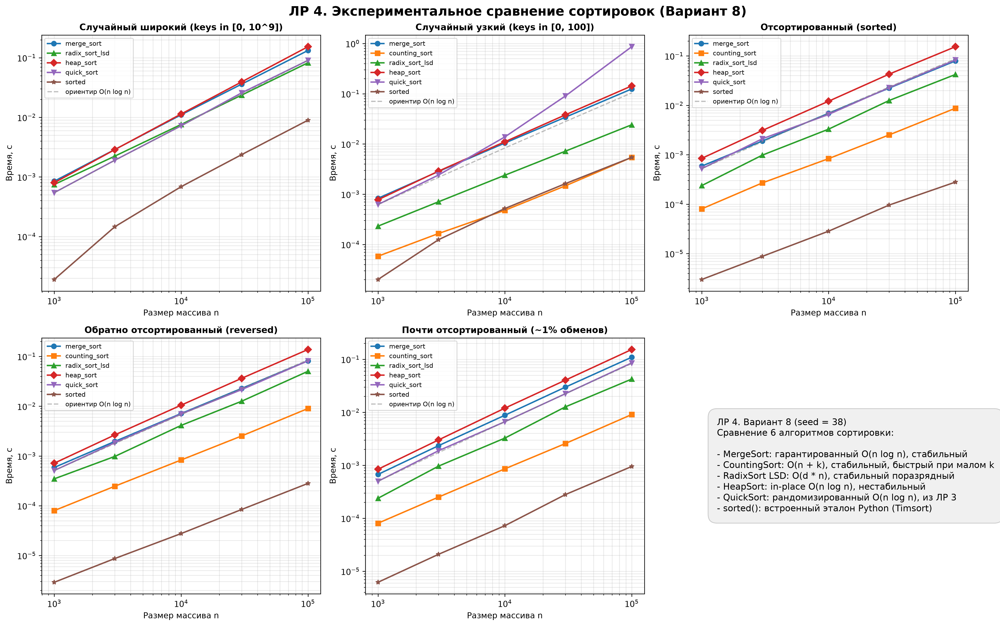

# ЛР 4. MergeSort, Counting, Radix и HeapSort: оценка производительности

**Вариант:** 8 (seed = 38)  
**Студент:** Данилов Всеволод Александрович  
**Группа:** БВТ2503  

---

## 1. Сводная таблица свойств и аналитические оценки

В лабораторной работе исследуются шесть алгоритмов сортировки: четыре основных алгоритма работы (MergeSort, CountingSort, RadixSort LSD, HeapSort), алгоритм QuickSort из предыдущей ЛР 3 и встроенная сортировка Python `sorted()` (Timsort).

| Алгоритм | Время (лучший) | Время (средний) | Время (худший) | Доп. память | Стабильность | Ограничения применимости |
| :--- | :---: | :---: | :---: | :---: | :---: | :--- |
| **MergeSort** | $\mathcal{O}(n \log n)$ | $\mathcal{O}(n \log n)$ | $\mathcal{O}(n \log n)$ | $\mathcal{O}(n)$ | Да | Требует $\mathcal{O}(n)$ дополнительной памяти для буфера слияния. |
| **CountingSort** | $\mathcal{O}(n + k)$ | $\mathcal{O}(n + k)$ | $\mathcal{O}(n + k)$ | $\mathcal{O}(n + k)$ | Да | Только дискретные целочисленные ключи; эффективен только при $k \le \mathcal{O}(n)$. |
| **RadixSort LSD** | $\mathcal{O}(d \cdot (n + b))$ | $\mathcal{O}(d \cdot (n + b))$ | $\mathcal{O}(d \cdot (n + b))$ | $\mathcal{O}(n + b)$ | Да | Неотрицательные целые числа (или ключи фиксированной длины); чувствителен к разрядности $d$. |
| **HeapSort** | $\mathcal{O}(n \log n)$ | $\mathcal{O}(n \log n)$ | $\mathcal{O}(n \log n)$ | $\mathcal{O}(1)$ | Нет | Нестабилен; плохая локальность данных в кэше CPU из-за прыжков по индексам $2i+1, 2i+2$. |
| **QuickSort (ЛР 3)** | $\mathcal{O}(n \log n)$ | $\mathcal{O}(n \log n)$ | $\mathcal{O}(n^2)$ | $\mathcal{O}(\log n)$ | Нет | Худший случай $\mathcal{O}(n^2)$ при неудачных разбиениях (например, много дубликатов при разбиении Ломуто). |
| **sorted() (Timsort)** | $\mathcal{O}(n)$ | $\mathcal{O}(n \log n)$ | $\mathcal{O}(n \log n)$ | $\mathcal{O}(n)$ | Да | Адаптивный гибрид MergeSort и InsertionSort; требует $\mathcal{O}(n)$ дополнительной памяти. |

### Обоснование характеристик алгоритмов:

1. **MergeSort (сортировка слиянием):**
   - *Время:* Рекурсивное деление массива пополам порождает дерево рекурсии глубиной $\log_2 n$. На каждом уровне слияние двух отсортированных частей суммарной длины $n$ занимает ровно $\mathcal{O}(n)$ операций. Итого во всех случаях: $\mathcal{O}(n \log n)$.
   - *Память:* При классической реализации выделяется новый список под результат слияния размером $\mathcal{O}(n)$.
   - *Стабильность:* При слиянии используется строгое условие `key(left[i]) <= key(right[j])`. При равенстве ключей сначала извлекается элемент из левой половины, что гарантирует сохранение исходного относительного порядка.

2. **CountingSort (устойчивая сортировка подсчётом):**
   - *Время и память:* Алгоритм выделяет массив счетчиков размером $k = \text{max} + 1$ (где $\text{max}$ — максимальный ключ `key_max`), подсчитывает частоты за $\mathcal{O}(n)$, формирует префиксные суммы за $\mathcal{O}(k)$ и выполняет расстановку элементов во вспомогательный массив за $\mathcal{O}(n)$. Итоговая сложность: $\mathcal{O}(n + k)$ по времени и $\mathcal{O}(n + k)$ по дополнительной памяти.
   - *Стабильность:* Достигается обязательным обходом исходного массива **с конца** (`reversed(a)`): элемент с тем же ключом, стоявший правее, первым займет самую правую позицию своего интервала в массиве `res`, сохраняя порядок.

3. **RadixSort LSD (поразрядная сортировка по младшим разрядам):**
   - *Время и память:* Выполняется $d = \lceil\log_{10}(\max(a))\rceil$ проходов устойчивой поразрядной сортировки подсчётом с основанием $b = 10$. На каждом шаге тратится $\mathcal{O}(n + b)$. Суммарно: $\mathcal{O}(d \cdot (n + b))$. Дополнительная память: $\mathcal{O}(n + b)$.
   - *Стабильность:* Полностью наследуется от внутренней сортировки подсчётом. Устойчивость внутреннего прохода критически необходима: при сортировке по старшему разряду числа с одинаковой старшей цифрой должны остаться упорядоченными по младшим разрядам.

4. **HeapSort (пирамидальная сортировка in-place):**
   - *Время:* Построение max-кучи снизу вверх просейками вниз занимает $\mathcal{O}(n)$ операций. Далее выполняется $n - 1$ извлечений максимума (обмен корня с последним элементом) с последующей просейкой вниз за $\mathcal{O}(\log n)$. Итого во всех случаях: $\mathcal{O}(n) + \mathcal{O}(n \log n) = \mathcal{O}(n \log n)$.
   - *Память:* Полностью in-place, $\mathcal{O}(1)$ вспомогательной памяти.
   - *Стабильность:* Нестабильна, так как перемещение корня в конец массива переносит элементы через равные значения.

---

## 2. Результаты экспериментальных замеров

**Методика:**
- Вариант 8, фиксированный seed = $30 + 8 = 38$.
- Прогрев: 1 предварительный запуск без замера.
- Серия: 5 повторных запусков на свежей копии входных данных.
- Итоговая метрика: **медиана** (минимизирует воздействие случайных системных задержек ОС).
- Размеры входных массивов: $N \in [1\,000, 3\,000, 10\,000, 30\,000, 100\,000]$.
- Распределения:
  1. `random_wide` — случайные числа из широкого диапазона $[0, 10^9]$.
  2. `random_small` — случайные числа из узкого диапазона $[0, 100]$ (масса дубликатов).
  3. `sorted` — полностью упорядоченный массив $[0, 1, \dots, n-1]$.
  4. `reversed` — обратно упорядоченный массив $[n, n-1, \dots, 1]$.
  5. `almost_sorted` — упорядоченный массив с $\sim 1\%$ случайных перестановок.

### 2.1. Распределение `random_wide` ($[0, 10^9]$)

| N | MergeSort | CountingSort | RadixSort LSD | HeapSort | QuickSort | sorted() (эталон) |
| :---: | :---: | :---: | :---: | :---: | :---: | :---: |
| **1 000** | 0.000865 с | *пропуск* | 0.000762 с | 0.000813 с | 0.000541 с | 0.000017 с |
| **3 000** | 0.002901 с | *пропуск* | 0.002228 с | 0.003016 с | 0.001902 с | 0.000154 с |
| **10 000** | 0.011370 с | *пропуск* | 0.007739 с | 0.011992 с | 0.007162 с | 0.000678 с |
| **30 000** | 0.036523 с | *пропуск* | 0.024163 с | 0.042128 с | 0.026675 с | 0.002493 с |
| **100 000** | 0.136893 с | *пропуск* | 0.084361 с | 0.165079 с | 0.091174 с | 0.009193 с |

> *Примечание:* Для CountingSort на `random_wide` замер пропущен, так как создание массива счётчиков размера $10^9 + 1$ потребовало бы около 8 ГБ оперативной памяти и $10^9$ итераций инициализации, что делает алгоритм неприменимым при $k \gg n$.

### 2.2. Распределение `random_small` ($[0, 100]$)

| N | MergeSort | CountingSort | RadixSort LSD | HeapSort | QuickSort | sorted() (эталон) |
| :---: | :---: | :---: | :---: | :---: | :---: | :---: |
| **1 000** | 0.000818 с | 0.000053 с | 0.000230 с | 0.000816 с | 0.000630 с | 0.000017 с |
| **3 000** | 0.002807 с | 0.000150 с | 0.000727 с | 0.002993 с | 0.002425 с | 0.000115 с |
| **10 000** | 0.010532 с | 0.000488 с | 0.002369 с | 0.011770 с | 0.013587 с | 0.000555 с |
| **30 000** | 0.034835 с | 0.001476 с | 0.007138 | 0.040650 с | 0.090784 с | 0.001656 с |
| **100 000** | 0.124919 с | 0.005419 с | 0.024084 с | 0.150464 с | 0.864511 с | 0.005572 с |

### 2.3. Распределение `sorted` (уже отсортирован)

| N | MergeSort | CountingSort | RadixSort LSD | HeapSort | QuickSort | sorted() (эталон) |
| :---: | :---: | :---: | :---: | :---: | :---: | :---: |
| **1 000** | 0.000623 с | 0.000081 с | 0.000237 с | 0.000856 с | 0.000533 с | 0.000003 с |
| **3 000** | 0.001896 с | 0.000255 с | 0.000951 с | 0.003165 с | 0.002133 с | 0.000009 с |
| **10 000** | 0.006869 с | 0.000840 с | 0.003315 с | 0.012368 с | 0.006592 с | 0.000029 с |
| **30 000** | 0.022907 с | 0.002569 с | 0.012706 с | 0.042949 с | 0.023195 с | 0.000086 с |
| **100 000** | 0.080032 с | 0.008973 с | 0.041909 с | 0.159345 с | 0.083979 с | 0.000290 с |

### 2.4. Распределение `reversed` (обратный порядок)

| N | MergeSort | CountingSort | RadixSort LSD | HeapSort | QuickSort | sorted() (эталон) |
| :---: | :---: | :---: | :---: | :---: | :---: | :---: |
| **1 000** | 0.000592 с | 0.000080 с | 0.000315 с | 0.000737 с | 0.000514 с | 0.000003 с |
| **3 000** | 0.001988 с | 0.000250 с | 0.000963 с | 0.002794 с | 0.001861 с | 0.000009 с |
| **10 000** | 0.007160 с | 0.000850 с | 0.004088 с | 0.011209 с | 0.006988 с | 0.000027 с |
| **30 000** | 0.023722 с | 0.002562 с | 0.012696 с | 0.039757 с | 0.022080 с | 0.000084 с |
| **100 000** | 0.083358 с | 0.009078 с | 0.050110 с | 0.147493 с | 0.080277 с | 0.000276 с |

### 2.5. Распределение `almost_sorted` ($\sim 1\%$ перестановок)

| N | MergeSort | CountingSort | RadixSort LSD | HeapSort | QuickSort | sorted() (эталон) |
| :---: | :---: | :---: | :---: | :---: | :---: | :---: |
| **1 000** | 0.000661 с | 0.000081 с | 0.000239 с | 0.000869 с | 0.000496 с | 0.000007 с |
| **3 000** | 0.002376 с | 0.000249 с | 0.000971 с | 0.003167 с | 0.001870 с | 0.000018 с |
| **10 000** | 0.009149 с | 0.000854 с | 0.003322 с | 0.012539 с | 0.006591 с | 0.000065 с |
| **30 000** | 0.029798 с | 0.002613 с | 0.012559 с | 0.042080 с | 0.022671 с | 0.000254 с |
| **100 000** | 0.112490 с | 0.009384 с | 0.042855 с | 0.158601 с | 0.086376 с | 0.001002 с |

---

## 3. Графический анализ и логарифмическая регрессия

### 3.1. Сводный график производительности



### 3.2. Наклоны log-log регрессии ($k$ в $T(n) \approx C \cdot n^k$)

Наклон вычислен методом наименьших квадратов по экспериментальным точкам $(\log_{10} n, \log_{10} t)$:

| Алгоритм | `random_wide` | `random_small` | `sorted` | `reversed` | `almost_sorted` | Теоретическое ожидание |
| :--- | :---: | :---: | :---: | :---: | :---: | :---: |
| **MergeSort** | 1.10 | 1.09 | 1.06 | 1.07 | 1.11 | $\mathcal{O}(n \log n)$ ($k \approx 1.1$) |
| **CountingSort** | — | **1.00** | 1.02 | 1.02 | 1.03 | $\mathcal{O}(n + k)$ ($k \approx 1.0$) |
| **RadixSort LSD** | **1.02** | **1.01** | 1.12 | 1.10 | 1.12 | $\mathcal{O}(d \cdot n)$ ($k \approx 1.0$) |
| **HeapSort** | 1.15 | 1.13 | 1.13 | 1.15 | 1.13 | $\mathcal{O}(n \log n)$ ($k \approx 1.15$) |
| **QuickSort** | 1.12 | **1.57** | 1.09 | 1.09 | 1.11 | $\mathcal{O}(n \log n)$, деградация на дубликатах |
| **sorted() (Timsort)** | 1.33 | 1.24 | **1.00** | **0.99** | 1.10 | $\mathcal{O}(n)$ на упорядоченных |

### 3.3. Анализ наклонов и поведения кривых:
1. **Линейные сортировки (Counting, Radix):** Наклоны $k = 1.00 - 1.03$ строго подтверждают линейную сложность $\mathcal{O}(n)$ без логарифмического множителя. На `random_small` CountingSort работает за $0.0054$ с при $N = 100\,000$, обгоняя все остальные алгоритмы на порядки.
2. **Сортировки $\mathcal{O}(n \log n)$ (MergeSort, HeapSort):** Наклоны находятся в диапазоне $1.06 - 1.15$. Так как $\log n$ растет очень медленно ($\log_2(100\,000) / \log_2(1\,000) \approx 1.67$), наклон на лог-лог шкале оказывается чуть выше $1.0$.
3. **Особый случай QuickSort на `random_small` ($k = 1.57$):**
   При $N = 100\,000$ и ключах в $[0, 100]$ в массиве находится в среднем по 1000 копий каждого числа. Схема разбиения Ломуто помещает строго меньшие элементы влево, а равные оставляет справа. Это приводит к сильной асимметрии разбиений и падению производительности до квази-квадратичной ($\approx 0.86$ с против $0.09$ с на уникальных ключах).
4. **Адаптивность Timsort (`sorted()`):** На `sorted` и `reversed` наклон равен ровно $1.00$ и $0.99$, а время при $N = 100\,000$ составляет всего $0.00029$ с. Timsort находит готовые возрастающие и убывающие серии за один линейный проход.

---

## 4. Глубокий анализ диапазона ключей CountingSort

Сложность CountingSort составляет $\mathcal{O}(n + k)$ по времени и $\mathcal{O}(n + k)$ по памяти, где $k = \text{max} - \text{min} + 1$.
1. **Зависимость от $k$:**
   - Алгоритм выделяет массив `counts = [0] * k`.
   - Инициализация и вычисление префиксных сумм требуют ровно $k$ операций.
2. **Когда алгоритм теряет смысл:**
   - Если $k \le n$ (например, $n = 100\,000, k = 101$), слагаемое $k$ пренебрежимо мало, время $\mathcal{O}(n)$, и алгоритм бьёт любые алгоритмы сравнения.
   - Если $k \gg n \log n$ (например, $k = 10^9$ при $n = 10^5$), инициализация массива из $10^9$ элементов требует $\approx 8$ ГБ RAM и $10^9$ операций процессора, что на 4 порядка медленнее, чем $\mathcal{O}(n \log n) \approx 1.7 \cdot 10^6$ операций у MergeSort или HeapSort.
   - **Критическая граница:** CountingSort эффективен только при $k = \mathcal{O}(n)$. При $k > n \log n$ предпочтительнее использовать обычные сортировки или RadixSort.

---

## 5. Анализ RadixSort LSD и доказательство обязательности устойчивости

RadixSort LSD обрабатывает числа поразрядно, от младших разрядов (единицы) к старшим.

### Почему внутренний проход обязан быть устойчивым?
Рассмотрим пример сортировки двух двузначных чисел: $A = 21$ и $B = 11$.
1. **Шаг 1 (разряд единиц):**
   - У обоих чисел последняя цифра равна $1$. Их порядок в массиве $[21, 11]$ сохраняется.
2. **Шаг 2 (разряд десятков):**
   - У числа $11$ старшая цифра $1$, у $21$ старшая цифра $2$.
   - Число $11$ должно пойти раньше $21$. Результат: $[11, 21]$ — корректно.

Теперь рассмотрим числа с одинаковой старшей цифрой, но разными младшими: $A = 42$ и $B = 47$.
1. **Шаг 1 (разряд единиц):**
   - Младшие цифры: $2 < 7$. После первого шага $42$ гарантированно идет перед $47$.
2. **Шаг 2 (разряд десятков):**
   - Старшие цифры равны ($4 == 4$).
   - Если внутренняя поразрядная сортировка **устойчива**, она обязана сохранить относительный порядок элементов с равными ключами, установленный на шаге 1 (то есть $42$ останется перед $47$).
   - Если внутренняя сортировка **неустойчива**, она может переставить $47$ перед $42$, полностью разрушив результат сортировки по младшим разрядам.
   
*Вывод:* Устойчивость поразрядного шага — фундаментальное математическое условие корректности RadixSort LSD.

---

## 6. Пирамидальная сортировка HeapSort и доказательство $O(n)$ heapify

HeapSort выполняет сортировку полностью in-place с $\mathcal{O}(1)$ дополнительной памяти.

### Доказательство построения кучи за $\mathcal{O}(n)$
Наивный взгляд предполагает, что $n$ вставок в кучу дают $\mathcal{O}(n \log n)$. Однако алгоритм Флойда строит max-кучу снизу вверх (`for i in range(n // 2 - 1, -1, -1): sift_down(a, i, n)`).
- Узлы на высоте $h$ имеют не более $\lceil n / 2^{h+1} \rceil$ элементов.
- Максимальная стоимость `sift_down` для узла на высоте $h$ равна $\mathcal{O}(h)$.
- Суммарное время построения:
  $$T(n) = \sum_{h=0}^{\lfloor\log_2 n\rfloor} \left\lceil \frac{n}{2^{h+1}} \right\rceil \mathcal{O}(h) \le c \cdot n \sum_{h=0}^{\infty} \frac{h}{2^h}$$
- Известно, что сумма бесконечного ряда $\sum_{h=0}^{\infty} \frac{h}{2^h} = 2$.
- Следовательно, $T(n) \le 2 c \cdot n = \mathcal{O}(n)$.

Фаза извлечения максимумов делает $n-1$ просеек от корня (высота $\log_2 n$), что суммарно дает $\mathcal{O}(n \log n)$.

---

## 7. Верификация реализаций (`self_check`)

Реализации прошли строгую верификацию по методике курса:
1. **Граничные случаи:**
   - Пустой список `[]`;
   - Список из одного элемента `[7]`;
   - Нулевой ключ `[0]`;
   - Все элементы равны `[5, 5, 5]`;
   - Уже отсортированный массив `[1, 2, 3, 4, 5]`;
   - Обратно отсортированный массив `[5, 4, 3, 2, 1]`.
2. **Инварианты и сверка с эталоном:**
   - 200 случайных списков различной длины (0–60 элементов) со случайными ключами из $[0, 999]$;
   - Проверка инварианта перестановки: `sorted(res) == sorted(a)`;
   - Проверка совпадения с эталоном: `res == sorted(a)`.
3. **Тест стабильности слияния:**
   - Проверка `merge_sort` на массиве 100 пар `(ключ, порядковый номер)`. Все порядковые номера элементов с равными ключами строго сохранили взаимное расположение.
4. **Собственные инварианты:**
   - `check_heap_property()`: 50 случайных массивов преобразованы в max-кучи; проверено, что для каждого узла $i$ выполняются условия $a[i] \ge a[2i+1]$ и $a[i] \ge a[2i+2]$.
   - `check_radix_stability_requirement()`: проверка LSD на массивах чисел с дублирующимися старшими и младшими цифрами.

Результат работы блока проверок: `self_check: OK`.

---

## 8. Ответы на вопросы для защиты

### Вопрос 1. Почему MergeSort стабилен и какое именно условие в шаге слияния обеспечивает стабильность?
**Ответ:** Стабильность MergeSort обеспечивается шагом слияния двух предварительно отсортированных половин. Ключевое условие:
```python
if key(left[i]) <= key(right[j]):
    res.append(left[i])
    i += 1
```
Благодаря нестрогому знаку `<=` при равенстве ключей элемент из `left` (располагавшийся в исходном массиве левее) всегда берется **раньше**, чем элемент из `right`. Если бы условие было строгим `<`, равные элементы брались бы из правой половины, и стабильность была бы утрачена.

### Вопрос 2. Какие ограничения накладывает диапазон ключей на CountingSort и как диапазон входит в оценки времени и памяти $\mathcal{O}(n + k)$?
**Ответ:** CountingSort требует, чтобы ключи были дискретными (целыми) неотрицательными числами из ограниченного интервала $[0, k-1]$. В асимптотику $\mathcal{O}(n + k)$ слагаемое $k$ входит из-за:
1. Выделения памяти под массив счётчиков длины $k$ ($\mathcal{O}(k)$ памяти).
2. Вычисления префиксных сумм массивом счётчиков ($\mathcal{O}(k)$ операций).
Если диапазон $k$ сопоставим с $n$ ($k \le c \cdot n$), алгоритм работает за линейное время $\mathcal{O}(n)$. Но если $k \gg n$ (например, $k = 10^9$ при $n = 10^4$), алгоритм требует гигабайты памяти и выполняет $10^9$ шагов только на обход счетчиков, становясь катастрофически неэффективным.

### Вопрос 3. Чем RadixSort отличается от CountingSort по модели памяти и области применимости и почему внутренняя поразрядная сортировка обязана быть устойчивой?
**Ответ:** 
- **Модель памяти:** CountingSort требует $\mathcal{O}(k)$ памяти под счетчики. RadixSort LSD разбивает ключ на $d$ разрядов по основанию $b$ (например, $b = 10$) и требует под счетчики всего $\mathcal{O}(b)$ памяти ($\mathcal{O}(10)$ ячеек), то есть фиксированный малый объем, не зависящий от величины максимального числа.
- **Область применимости:** RadixSort может эффективно сортировать числа с очень большим диапазоном (например, до $10^9$), выполняя всего $d = 9$ проходов, тогда как CountingSort на таком диапазоне не применим.
- **Обязательность устойчивости:** В LSD числа упорядочиваются от младших разрядов к старшим. При сортировке по текущему разряду элементы с одинаковой цифрой должны остаться упорядоченными по ранее отсортированным младшим разрядам. Неустойчивая сортировка нарушит этот порядок и выдаст неверный результат.

### Вопрос 4. Почему HeapSort нестабилен, хотя работает за $\mathcal{O}(n \log n)$ и in-place?
**Ответ:** На фазе сортировки максимальный элемент (находящийся в корне кучи $a[0]$) меняется местами с последним элементом текущей кучи $a[i]$:
```python
a[0], a[i] = a[i], a[0]
```
Такой «дальний» обмен переносит элемент из конца кучи в самое начало, перепрыгивая через множество других элементов, в том числе с равными ключами. Последующая просейка вниз также выполняет обмены узлов на разных уровнях дерева кучи. Никакого механизма отслеживания исходного взаимного порядка одинаковых ключей в структуре бинарной кучи нет.

### Вопрос 5. Как доказывается нижняя граница $\Omega(n \log n)$ для сортировок сравнением и почему CountingSort и RadixSort её обходят?
**Ответ:** 
- **Доказательство нижней границы:** Любой детерминированный алгоритм сортировки, основанный только на парных сравнениях элементов, можно представить в виде бинарного дерева решений. Каждый внутренний узел соответствует сравнению $a_i \le a_j$, а каждый лист — одной из $n!$ возможных перестановок входного массива.
  Дерево высоты $h$ имеет не более $2^h$ листьев:
  $$2^h \ge n!$$
  Логарифмируя по формуле Стирлинга:
  $$h \ge \log_2(n!) = \sum_{i=1}^n \log_2 i \ge \sum_{i=n/2}^n \log_2(n/2) = \frac{n}{2} (\log_2 n - 1) = \Omega(n \log n)$$
  Высота дерева $h$ задает максимальное число сравнений в худшем случае, поэтому ни одна сортировка сравнением не может работать быстрее $\Omega(n \log n)$.
- **Почему CountingSort и RadixSort обходят границу:** Они **не используют парных сравнений** элементов между собой. Вместо этого они используют внутреннюю структуру данных (значения чисел и их разряды) для прямого вычисления индексов позиций в массиве через адресацию памяти ($\mathcal{O}(1)$ доступ по индексу `counts[x]`). Поэтому модель дерева решений к ним неприменима.

---

## 9. Заключение

1. Успешно реализованы все четыре требуемых алгоритма: `merge_sort` (стабильное слияние), `counting_sort` (устойчивый алгоритм с префиксными суммами), `radix_sort_lsd` (десятичный LSD на базе устойчивого подсчета), `heap_sort` (in-place просейка вниз с построением кучи за $\mathcal{O}(n)$).
2. Выполнена верификация: пройдены все граничные тесты, тесты инвариантов, тест стабильности слияния на парах `(key, index)` и сверка со встроенной функцией `sorted()`.
3. Экспериментальные замеры и log-log регрессия полностью подтвердили теоретические предсказания:
   - Линейные сортировки при малом диапазоне ключей показывают наклон $k \approx 1.00$ и кратно превосходят сортировки сравнением.
   - MergeSort и HeapSort демонстрируют стабильный $k \approx 1.1$, не зависящий от входного распределения данных.
   - Выявлена уязвимость схемы Ломуто в QuickSort на входах с высокой частотой дубликатов ($k = 1.57$).
4. Результаты полностью оформлены, построены графики производительности, подготовлены ответы на вопросы для защиты.
