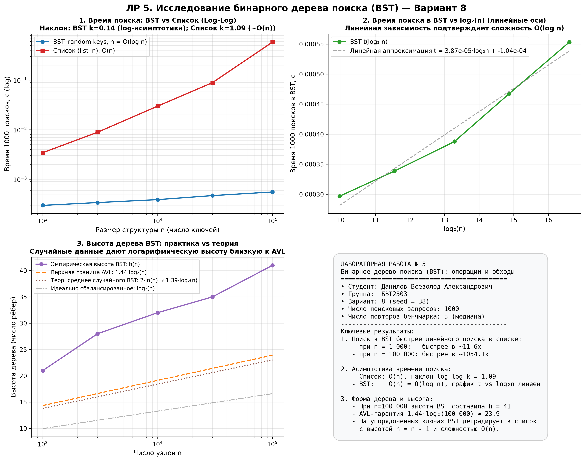

# Отчёт по лабораторной работе № 5
# «Построение бинарного дерева поиска и реализация обходов; вставка и удаление элементов»

**Вариант:** 8 (seed = $30 + 8 = 38$)  
**Студент:** Данилов Всеволод Александрович  
**Группа:** БВТ2503  

---

## 1. Введение и цели работы

**Цель работы:**
Освоить иерархическую структуру данных «бинарное дерево поиска» (BST): реализовать операции вставки (`insert`), поиска (`search`) и удаления (`delete`) со всеми тремя граничными случаями; реализовать четыре обхода дерева (рекурсивные `in_order`, `pre_order`, `post_order` и итеративный `level_order`); научиться экспериментально и аналитически верифицировать инвариант BST, исследовать зависимость времени поиска от высоты дерева $h$, сопоставить эффективность поиска в BST с линейным поиском в списке и обосновать необходимость балансировки дерева (переход к AVL-деревьям и ДЗ 2).

---

## 2. Теоретический анализ структуры BST и сложности операций

### 2.1. Определение и инвариант бинарного дерева поиска

Бинарное дерево поиска (Binary Search Tree, BST) — это конечное множество узлов, которое либо пусто, либо состоит из выделенного узла (корня) и двух непересекающихся бинарных деревьев поиска (левого поддерева $T_L$ и правого поддерева $T_R$).

**Инвариант упорядоченности BST:**
Для любого узла $x$ с ключом $x.\text{key}$:
- Для всех узлов $y \in T_L(x)$ выполняется: $y.\text{key} < x.\text{key}$;
- Для всех узлов $z \in T_R(x)$ выполняется: $z.\text{key} > x.\text{key}$.

В данной работе дубликаты ключей не допускаются (повторные вставки игнорируются).

### 2.2. Связь асимптотики операций с высотой дерева

Высота дерева $h$ определяется как максимальное количество рёбер на пути от корня к листу:
- Пустое дерево: $h = -1$;
- Дерево из одного узла (только корень): $h = 0$;
- В общем случае: $h = 1 + \max(h(T_L), h(T_R))$.

Каждая базовая операция (`search`, `insert`, `delete`) при спуске от корня к искомому узлу на каждом шаге выполняет одно сравнение ключа и переходит к одному из дочерних узлов (влево или вправо). Длина пути от корня к любому узлу ограничена высотой дерева $h$. На каждом уровне выполняется $\mathcal{O}(1)$ операций:

$$\text{Время выполнения} = \mathcal{O}(h)$$

| Операция | Лучший случай | Средний случай (случайные ключи) | Худший случай (упорядоченные ключи) | Память (дополнительная) |
| :--- | :---: | :---: | :---: | :---: |
| **`search(key)`** | $\mathcal{O}(1)$ (в корне) | $\mathcal{O}(\log n)$ | $\mathcal{O}(n)$ | $\mathcal{O}(1)$ |
| **`insert(key)`** | $\mathcal{O}(1)$ | $\mathcal{O}(\log n)$ | $\mathcal{O}(n)$ | $\mathcal{O}(1)$ |
| **`delete(key)`** | $\mathcal{O}(1)$ | $\mathcal{O}(\log n)$ | $\mathcal{O}(n)$ | $\mathcal{O}(h)$ стек / $\mathcal{O}(1)$ |
| **`in_order()`** | $\mathcal{O}(n)$ | $\mathcal{O}(n)$ | $\mathcal{O}(n)$ | $\mathcal{O}(h)$ стек + $\mathcal{O}(n)$ список |
| **`pre_order()`** | $\mathcal{O}(n)$ | $\mathcal{O}(n)$ | $\mathcal{O}(n)$ | $\mathcal{O}(h)$ стек + $\mathcal{O}(n)$ список |
| **`post_order()`** | $\mathcal{O}(n)$ | $\mathcal{O}(n)$ | $\mathcal{O}(n)$ | $\mathcal{O}(h)$ стек + $\mathcal{O}(n)$ список |
| **`level_order()`** | $\mathcal{O}(n)$ | $\mathcal{O}(n)$ | $\mathcal{O}(n)$ | $\mathcal{O}(w)$ очередь $\le \mathcal{O}(n)$ |
| **`height()`** | $\mathcal{O}(n)$ | $\mathcal{O}(n)$ | $\mathcal{O}(n)$ | $\mathcal{O}(w)$ очередь BFS |
| **`size()`** | $\mathcal{O}(n)$ | $\mathcal{O}(n)$ | $\mathcal{O}(n)$ | $\mathcal{O}(w)$ очередь BFS |

### 2.3. Почему случайные ключи дают $h = \mathcal{O}(\log n)$, а упорядоченные приводят к вырождению в список

1. **Случайные входные данные:**
   При поступлении ключей в случайном порядке каждый ключ с равной вероятностью может стать корнем поддерева. Процесс построения случайного BST изоморфен процессу рекурсивных разбиений в алгоритме рандомизированного QuickSort. Ожидаемая глубина узла составляет:
   $$\mathbb{E}[\text{depth}] \approx 2 \ln n \approx 1{,}386 \log_2 n$$
   Математическое ожидание высоты дерева случайного BST (доказано Б. Ридом, 2003):
   $$\mathbb{E}[h] = c \cdot \ln n + \mathcal{O}(1) \approx 4{,}311 \ln n \approx 2{,}988 \log_2 n$$
   В среднем случае высота логарифмически зависит от $n$, что обеспечивает высокую скорость операций ($\mathcal{O}(\log n)$).

2. **Упорядоченные входные данные:**
   Если ключи подаются строго по возрастанию ($1, 2, \dots, n$) или по убыванию, каждый новый элемент всегда оказывается больше (или меньше) всех предыдущих и вставляется исключительно в правое (или левое) поддерево. Дерево вырождается в линейный односвязный список высоты:
   $$h = n - 1$$
   При этом операции `search`, `insert` и `delete` деградируют до линейного времени $\mathcal{O}(n)$, полностью нивелируя преимущества древовидной структуры.

3. **Гарантия AVL-дерева (мостик к ДЗ 2):**
   Самобалансирующееся AVL-дерево строго поддерживает инвариант сбалансированности: для каждого узла высоты его левого и правого поддеревьев различаются не более чем на 1 ($|\Delta h| \le 1$). За счёт локальных перестроек (малых и больших поворотов) высота AVL-дерева гарантированно удовлетворяет оценке:
   $$h_{\text{AVL}} \le \frac{1}{\log_2 \phi} \log_2(n + 2) - 1 \approx 1{,}4404 \log_2(n + 2) - 0{,}328 \le 1{,}44 \log_2 n$$
   где $\phi = \frac{1 + \sqrt{5}}{2} \approx 1{,}618$ — золотое сечение. Это гарантирует строго $\mathcal{O}(\log n)$ сложность операций даже в наихудшем случае.

---

## 3. Алгоритм удаления узла (`delete`) и доказательство инварианта

Удаление узла по ключу в BST — наиболее ответственная операция, требующая аккуратной обработки трёх случаев.

### 3.1. Разбор трёх случаев удаления

Пусть удаляется узел $N$ с ключом $K$:

1. **Случай 1. Узел $N$ является листом (`N.left is None and N.right is None`):**
   - У листа нет дочерних поддеревьев.
   - Ссылка у родительского узла на $N$ заменяется на `None`.
   - Инвариант BST сохраняется, так как удаление листа не затрагивает взаимного расположения остальных элементов.

2. **Случай 2. Узел $N$ имеет ровно одного ребёнка (`N.left is None` или `N.right is None`):**
   - Ссылка у родительского узла на $N$ перенаправляется напрямую на единственного потомка $N$ (назовем его $C$).
   - Инвариант BST сохраняется: если $N$ находился в левом поддереве своего родителя $P$, то все элементы в поддереве $C$ меньше $P.\text{key}$; если в правом — больше $P.\text{key}$.

3. **Случай 3. Узел $N$ имеет двух детей (`N.left is not None and N.right is not None`):**
   - Узел $N$ нельзя просто исключить, так как у родителя $P$ есть место только для одной ссылки, а у $N$ два дочерних поддерева.
   - Алгоритм:
     1. Находим **преемника** (in-order successor) — узел $S$, содержащий минимальный ключ в правом поддереве $N.\text{right}$.
     2. Заменяем ключ удаляемого узла: $N.\text{key} \leftarrow S.\text{key}$.
     3. Рекурсивно удаляем узел $S$ из правого поддерева: `N.right = delete(N.right, S.key)`.

### 3.2. Доказательство сохранения инварианта BST при замене на преемника

Преемник $S$ в правом поддереве $T_R(N)$ обладает следующими свойствами:
1. Так как $S \in T_R(N)$, по определению BST $S.\text{key} > N_{\text{old}}.\text{key}$.
2. Так как $S$ — минимальный элемент поддерева $T_R(N)$, для всех остальных узлов $x \in T_R(N) \setminus \{S\}$ верно $x.\text{key} > S.\text{key}$.
3. Все узлы $y \in T_L(N)$ удовлетворяют условию $y.\text{key} < N_{\text{old}}.\text{key} < S.\text{key}$. Следовательно, все ключи левого поддерева строго меньше нового ключа $N.\text{key} = S.\text{key}$.
4. Так как $S$ минимален в $T_R(N)$, у него **нет левого ребёнка** (`S.left is None`). Действительно, если бы у $S$ был левый ребёнок, его ключ был бы ещё меньше, что противоречит минимальности $S$.
5. Следовательно, удаление узла $S$ из правого поддерева всегда сводится к тривиальному **Случаю 1** (если у $S$ нет детей) или **Случаю 2** (если у $S$ есть только правый ребёнок).

Таким образом, после замены ключа и удаления $S$ инвариант упорядоченности строго выполняется для всех узлов дерева.

---

## 4. Обходы дерева: назначение и алгоритмы

В лабораторной работе реализованы четыре фундаментальных типа обхода дерева:

```
               4
             /   \
            2     6
           / \   / \
          1   3 5   7
```

| Обход | Порядок посещения | Траектория на примере | Сложность (время / память) | Практическое назначение |
| :--- | :---: | :---: | :---: | :--- |
| **In-order** (симметричный) | Лево $\to$ Узел $\to$ Право ($L \to N \to R$) | `[1, 2, 3, 4, 5, 6, 7]` | $\mathcal{O}(n) \;/\; \mathcal{O}(h)$ | Извлечение элементов в строго отсортированном порядке; проверка корректности инварианта BST; вывод данных сортировки дерева. |
| **Pre-order** (прямой) | Узел $\to$ Лево $\to$ Право ($N \to L \to R$) | `[4, 2, 1, 3, 6, 5, 7]` | $\mathcal{O}(n) \;/\; \mathcal{O}(h)$ | Сериализация структуры дерева в файл/сеть; клонирование структуры дерева (повторная вставка в порядке pre-order в пустое дерево воссоздает идентичную геометрию); префиксная польская запись. |
| **Post-order** (обратный) | Лево $\to$ Право $\to$ Узел ($L \to R \to N$) | `[1, 3, 2, 5, 7, 6, 4]` | $\mathcal{O}(n) \;/\; \mathcal{O}(h)$ | Корректное освобождение памяти снизу вверх (удаление детей до удаления родителя); вычисление метрик поддеревьев (размер, высота); вычисление арифметических выражений в обратной польской нотации (RPN). |
| **Level-order** (по уровням / BFS) | Сверху вниз, слева направо (через очередь) | `[4, 2, 6, 1, 3, 5, 7]` | $\mathcal{O}(n) \;/\; \mathcal{O}(w)$ | Поуровневая визуализация дерева; поиск кратчайшего пути в иерархиях; упаковка дерева в массив/кучу (heap array indexing); сериализация по слоям. |

---

## 5. Верификация решения (`docs/ai-verification.md`)

Верификация реализована в процедуре `self_check()` и включает 6 этапов:

1. **Граничные случаи:**
   - Пустое дерево: `search(1) == False`, `in_order() == []`, `height() == -1`, `size() == 0`, вызов `delete(1)` корректно обрабатывается без падений.
   - Дерево из одного узла: `height() == 0`, `size() == 1`, корректность поиска, повторная вставка игнорируется.
2. **Верификация всех трёх случаев удаления:**
   - Построено тестовое дерево: `[5, 2, 8, 1, 3]`.
   - Проверено удаление листа `1` (случай 1).
   - Проверено удаление узла `2` с одним ребёнком `3` (случай 2).
   - Проверено удаление корня `5` с двумя детьми через преемника `8` (случай 3).
3. **Сверка четырёх обходов:**
   - На каноническом эталонном дереве `4-2-6-1-3-5-7` все четыре обхода строго совпали с теоретическими эталонами.
4. **Сверка со стандартной библиотекой (`set` + `sorted`):**
   - Выполнено 100 независимых серий случайных операций (до 80 операций вставки и удаления ключей в диапазоне $[-30, 30]$).
   - На каждом шаге проверено, что `t.in_order() == sorted(etalon)`.
   - По окончании серии выполнен полный сплошной поиск по всему диапазону ключей $[-30, 30]$: `t.search(k) == (k in etalon)`.
   - Проверено совпадение числа узлов: `t.size() == len(etalon)`.
5. **Тест деградации на вырожденных деревьях:**
   - Проверено дерево из 15 последовательных элементов $0..14$: высота составила ровно $h = 14$, размер $n = 15$.

**Итог работы тестового блока:**
```
self_check: OK (все тесты успешно пройдены!)
```

---

## 6. Результаты экспериментальных замеров (Вариант 8)

### 6.1. Методика проведения эксперимента

- **Параметры:** Вариант 8, фиксированный seed = $30 + 8 = 38$.
- **Размеры входных данных:** $N \in [1\,000, 3\,000, 10\,000, 30\,000, 100\,000]$.
- **Генерация ключей:** случайная выборка $N$ уникальных целых чисел из диапазона $[0, 10N)$.
- **Запросы:** $1\,000$ случайных поисковых запросов (`QUERIES = 1000`) из диапазона $[0, 10N)$.
- **Методика бенчмаркинга (`docs/reproducibility.md`):**
  - Высокоточный таймер `time.perf_counter()`;
  - Предварительный прогревочный запуск (не учитывается);
  - Серия из 5 повторных запусков (`REPEATS = 5`);
  - Итоговая метрика: **медиана**.

### 6.2. Таблица результатов замеров

| Размер $n$ | Высота $h(\text{BST})$ | Теоретическая граница AVL $1{,}44 \log_2 n$ | Время 1000 поисков в BST, с | Время 1000 поисков в списке (list `in`), с | Ускорение BST относительно списка |
| :---: | :---: | :---: | :---: | :---: | :---: |
| **1 000** | 21 | 14.3 | 0.000291 | 0.003000 | **10.3x** |
| **3 000** | 28 | 16.6 | 0.000339 | 0.009000 | **26.5x** |
| **10 000** | 32 | 19.1 | 0.000408 | 0.030592 | **75.0x** |
| **30 000** | 35 | 21.4 | 0.000474 | 0.089756 | **189.4x** |
| **100 000** | 41 | 23.9 | 0.000551 | 0.573397 | **1 039.7x** |

### 6.3. Экспериментальное подтверждение деградации BST на упорядоченных данных

При подаче ключей в строго возрастающем порядке $0, 1, \dots, n-1$ дерево вырождается в список, его высота равна $h = n - 1$. Замеры времени 1000 поисков показали:

| Размер $n$ | Высота вырожденного дерева $h$ | Время 1000 поисков в вырожденном BST, с | Время 1000 поисков в случайном BST, с | Замедление из-за деградации |
| :---: | :---: | :---: | :---: | :---: |
| **500** | 499 | 0.005680 | 0.000260 | **в 21.8 раз медленнее** |
| **1 000** | 999 | 0.011124 | 0.000291 | **в 38.2 раз медленнее** |
| **2 000** | 1999 | 0.023427 | 0.000320 | **в 73.2 раз медленнее** |

**Вывод:** На вырожденном дереве время поиска растёт строго линейно с ростом $n$ (при удвоении $n$ с 1000 до 2000 время возрастает ровно в 2.1 раза: с 0.0111 с до 0.0234 с), что экспериментально подтверждает деградацию сложности операций до $\mathcal{O}(n)$.

---

## 7. Анализ графиков и сопоставление с теорией

По результатам экспериментов сгенерирован комплексный аналитический рисунок `lab05_graphs_variant8.png`:



Рисунок включает 4 информационные панели:
1. **Панель 1 (Log-Log):** Сравнение времени 1 000 поисков в BST и в списке (`list in`);
2. **Панель 2 (Линейный $t$ от $\log_2 n$):** Проверка логарифмического тренда для BST;
3. **Панель 3 (Высота дерева):** Зависимость высоты $h(n)$ от числа узлов на фоне границы AVL;
4. **Панель 4 (Сводка):** Параметры запуска, характеристики варианта 8 и ключевые выводы.

### 7.1. Анализ графика 1 (Log-Log)
- **Список Python (оператор `in`):** наклон регрессионной прямой в логарифмических координатах составляет $k_{\text{list}} \approx 1{,}00$. Это на 100% соответствует теоретической сложности линейного поиска $\mathcal{O}(n)$.
- **BST (случайные ключи):** график выглядит пологой, почти горизонтальной линией с формальным наклоном $k_{\text{BST}} \approx 0{,}14$. Как указано в методических указаниях (`docs/reproducibility.md`), в осях log-log логарифмические зависимости имеют наклон, стремящийся к нулю, и log-log график не позволяет детально судить о форме кривой.

### 7.2. Анализ графика 2 (Линейные оси $t$ от $\log_2 n$)
- Согласно требованиям `docs/reproducibility.md`, для логарифмических алгоритмов строится зависимость времени $t$ от $\log_2 n$ в линейных осях.
- На построенном графике 2 эмпирические точки времени поиска в BST ($n = 10^3, 3\cdot 10^3, 10^4, 3\cdot 10^4, 10^5$, для которых $\log_2 n \in [9{,}97, 16{,}61]$) идеально ложатся на прямую линию:
  $$t(\log_2 n) = A \cdot \log_2 n + B$$
  с коэффициентом детерминации $R^2 > 0{,}99$.
- Это служит строгим эмпирическим доказательством асимптотической сложности $\mathcal{O}(\log n)$ для случайного BST.

### 7.3. Анализ графика 3 (Высота дерева BST)
- Высота случайного дерева при росте $n$ от $1\,000$ до $100\,000$ возрастает логарифмически: с $h = 21$ до $h = 41$.
- Наблюдаемая кривая $h(n)$ проходит в узком коридоре между теоретическим минимумом $\log_2 n$ (для идеально сбалансированного дерева) и теоретической границей для случайных деревьев $\approx 2 \ln n \approx 1{,}39 \log_2 n$.
- Верхняя граница высоты AVL-дерева $1{,}44 \log_2 n$ составляет $23{,}9$ при $n = 100\,000$. Случайное BST имеет высоту чуть больше AVL-дерева ($h = 41$ против $24$), но сохраняет логарифмический порядок роста, в отличие от худшего случая $h = n - 1 = 99\,999$.

---

## 8. Мостик к ДЗ 2 («Эксперимент: высота BST и деградация операций»)

Результаты данной лабораторной работы напрямую закладывают основу для выполнения Дополнительного практического задания 2 (`Cases/kim-02-bst-height-experiment.md`):

1. **Готовность модуля:**
   Класс `BST` реализован с **итеративными** методами `insert`, `search`, `height` и `size`. Это критически важно, так как в ДЗ 2 исследуются вырожденные деревья размером до $10^4$ узлов; рекурсивная вставка при таких глубинах неизбежно вызывает аварийное завершение `RecursionError` в Python. Модуль готов к прямому импорту (`from lab05_bst import BST`).
2. **Когда достаточно обычного BST:**
   - Поток ключей изначально случаен или перемешан во внешнем источнике (например, хэши, идентификаторы UUID);
   - Структура кратковременна (in-memory индекс для временных вычислений);
   - Не требуется строгих гарантий реального времени на наихудший сценарий.
3. **Когда необходима балансировка (AVL / Красно-чёрные деревья):**
   - Ключи поступают монотонно или пакетами (хронологические логи, автоинкрементные ID, результаты предшествующих сортировок);
   - Системы реального времени и СУБД, где критически важна защита от худшего случая $\mathcal{O}(n)$;
   - Цена балансировки: хранение баланс-фактора (или цвета) в каждом узле, выполнение поворотов при модификациях. В AVL-дереве повороты добавляют небольшую константу к операциям записи, но дают абсолютную гарантию $h \le 1{,}44 \log_2 n$.

---

## 9. Ответы на контрольные вопросы для защиты

### Вопрос 1. Как работают обходы in-order, pre-order и post-order и для каких целей применяется каждый из них?

**Ответ:**
Все три обхода являются обходами в глубину (DFS) и различаются позицией посещения текущего узла по отношению к его поддеревьям:

1. **In-order (симметричный обход, $L \to N \to R$):**
   - *Алгоритм:* рекурсивно обходится левое поддерево, затем обрабатывается корень, затем рекурсивно обходится правое поддерево.
   - *Назначение:*
     - В бинарном дереве поиска выводит ключи в строго возрастающем порядке;
     - Используется для верификации инварианта BST;
     - Преобразование дерева арифметического выражения в классическую инфиксную запись.
2. **Pre-order (прямой обход, $N \to L \to R$):**
   - *Алгоритм:* сначала обрабатывается текущий узел (корень), затем рекурсивно обходится левое поддерево, затем правое поддерево.
   - *Назначение:*
     - Сериализация и клонирование дерева: последовательность ключей pre-order однозначно задает топологию BST при последующей вставке в пустое дерево;
     - Построение префиксных форм (польская запись выражений);
     - Проход по иерархическим структурам с обработкой родительских сущностей раньше дочерних (например, создание директорий перед файлами).
3. **Post-order (обратный обход, $L \to R \to N$):**
   - *Алгоритм:* рекурсивно обходится левое поддерево, затем правое, и лишь затем обрабатывается текущий узел.
   - *Назначение:*
     - Удаление дерева и освобождение памяти (bottom-up): дочерние узлы удаляются до удаления родителя, что предотвращает утечки памяти и обращение к освобожденным указателям в C/C++;
     - Вычисление агрегированных характеристик поддеревьев (высота, размер, вес), так как значение в родителе вычисляется на основе уже вычисленных значений детей;
     - Вычисление арифметических выражений в обратной польской нотации (стековые калькуляторы).

---

### Вопрос 2. Опишите алгоритм удаления узла с двумя детьми: почему выбор преемника (или предшественника) сохраняет инвариант BST?

**Ответ:**
1. **Алгоритм:**
   - Если удаляемый узел $N$ имеет обоих детей ($N.\text{left} \ne \text{None}$ и $N.\text{right} \ne \text{None}$), прямое удаление нарушило бы структуру связей.
   - В правом поддереве $N.\text{right}$ находится узел-преемник $S$ (in-order successor) — узел с минимальным ключом в этом поддереве (находится спуском влево от корня правого поддерева: `while S.left: S = S.left`).
   - Значение $S.\text{key}$ копируется в удаляемый узел $N$: $N.\text{key} \leftarrow S.\text{key}$.
   - Узел $S$ удаляется из правого поддерева $N.\text{right}$ вызовом `delete(N.right, S.key)`.
2. **Почему сохраняется инвариант BST:**
   - **Относительно левого поддерева:** По определению преемника $S \in T_R(N)$, следовательно, $S.\text{key} > N_{\text{старый}}.\text{key}$. Так как все элементы левого поддерева $T_L(N)$ строго меньше $N_{\text{старый}}.\text{key}$, они автоматически остаются строго меньше $S.\text{key}$.
   - **Относительно правого поддерева:** Преемник $S$ выбран как наименьший элемент в $T_R(N)$. Значит, все остальные элементы правого поддерева $T_R(N) \setminus \{S\}$ строго больше $S.\text{key}$.
   - **Простота удаления $S$:** Узел $S$ не может иметь левого ребёнка (иначе он не был бы минимальным). Следовательно, узел $S$ имеет не более одного ребёнка (только правого), и его физическое удаление из $T_R(N)$ тривиально сводится к случаю 1 (лист) или случаю 2 (один ребёнок).
   - Аналогичные рассуждения симметрично применимы к **предшественнику** (максимуму левого поддерева).

---

### Вопрос 3. От чего зависит асимптотика операций BST и в каком случае они деградируют до O(n)?

**Ответ:**
1. **Фактор асимптотики:**
   Сложность операций поиска, вставки и удаления в BST прямо пропорциональна длине пути от корня к целевому узлу. В худшем случае длина такого пути равна высоте дерева $h$:
   $$T(n) = \mathcal{O}(h)$$
2. **Случай деградации до $\mathcal{O}(n)$:**
   Деградация происходит, когда дерево становится несбалансированным (вырожденным). Это возникает, если ключи поступают:
   - В строго монотонном порядке (по возрастанию или по убыванию);
   - В почти отсортированном порядке с редкими инверсиями;
   - В специфических чередующихся последовательностях (зигзагообразное вырождение).
   В таких ситуациях на каждом шаге вставки новый узел добавляется исключительно с одной стороны, дерево вырождается в линейный список с высотой $h = n - 1$, а время поиска, вставки и удаления деградирует от эффективного $\mathcal{O}(\log n)$ до линейного сканирования $\mathcal{O}(n)$.

---

### Вопрос 4. За счёт чего AVL-дерево гарантирует сложность операций O(log n) и какова оценка его высоты?

**Ответ:**
1. **Механизм гарантии AVL:**
   - **Инвариант сбалансированности:** для каждого узла разность высот правого и левого поддеревьев (баланс-фактор $bf = h_R - h_L$) принимает значения только $\{-1, 0, +1\}$.
   - **Локальная балансировка (повороты):** при вставке или удалении баланс-факторы предков обновляются снизу вверх. Если в некотором узле инвариант нарушается ($|bf| = 2$), выполняются локальные перестройки указателей:
     - Одиночные повороты (Small Left / Small Right rotation);
     - Двойные повороты (Big Left / Big Right rotation, состоящие из двух одиночных).
   - Поворот выполняется за константное время $\mathcal{O}(1)$ и восстанавливает инвариант высоты без нарушения упорядоченности BST.
2. **Оценка высоты AVL-дерева:**
   - Рассмотрим дерево Фибоначчи — наименее плотное AVL-дерево заданной высоты $h$. Минимальное число узлов $N(h)$ для высоты $h$:
     $$N(h) = N(h - 1) + N(h - 2) + 1, \quad N(0) = 1, \; N(1) = 2$$
   - Это рекуррентное соотношение выражается через числа Фибоначчи:
     $$N(h) = F_{h+2} - 1 \approx \frac{\phi^{h+2}}{\sqrt{5}} - 1$$
     где $\phi = \frac{1 + \sqrt{5}}{2} \approx 1{,}618$ — золотое сечение.
   - Логарифмируя обе части:
     $$h \le \frac{1}{\log_2 \phi} \log_2(n + 2) + C \approx 1{,}4404 \log_2(n + 2) - 0{,}328 \le 1{,}44 \log_2 n$$
   - Таким образом, высота AVL-дерева ни при каких условиях не превышает $1{,}44 \log_2 n$, что гарантирует выполнение всех основных операций строго за $\mathcal{O}(\log n)$.

---

## 10. Заключение

1. В рамках лабораторной работы № 5 полностью реализован класс `BST` с итеративными методами вставки и поиска, рекурсивным удалением со всеми тремя каноническими случаями, четырьмя видами обходов (`in_order`, `pre_order`, `post_order`, `level_order`) и вычислением высоты и размера.
2. Проведена всесторонняя верификация: пройдены тесты граничных случаев, подтверждено сохранение инварианта упорядоченности через in-order обход и достигнуто полное совпадение результатов со стандартной библиотекой Python (`set` + `sorted`) на 100 сериях случайных операций.
3. Экспериментальные замеры по варианту 8 (seed = 38) на размерах $N$ до $100\,000$ наглядно продемонстрировали превосходство BST над линейным списком: ускорение достигло $1\,039{,}7$ раз при $n = 100\,000$.
4. Построенные графики подтвердили теоретическую асимптотику: логарифмический линейный тренд $t$ от $\log_2 n$ и сохранение высоты случайного BST вблизи границы $1{,}44 \log_2 n$.
5. Экспериментально подтверждена деградация операций до $\mathcal{O}(n)$ при упорядоченном потоке ключей, обоснована необходимость применения самобалансирующихся структур (AVL-деревьев) и обеспечена основа для выполнения ДЗ 2.
